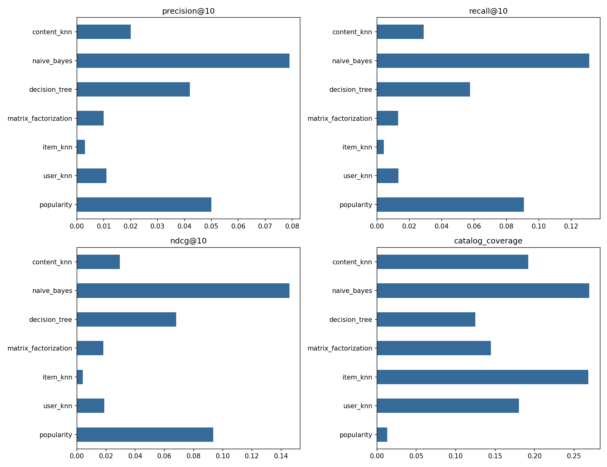

# Book recommendation: collaborative filtering versus content models

This project compares six lecture-based algorithms and a popularity baseline on
[Goodbooks-10k](https://github.com/zygmuntz/goodbooks-10k). Every algorithm has a
separate file under `algorithms/`. The shared experiment script prepares data,
trains models, evaluates recommendations, and saves tables and figures.

## Clone and run

Requirements: Git, Python 3.10 or newer, and an internet connection for the first
dataset download.

1. Clone the repository and open the project directory:

   ```sh
   git clone https://github.com/BodaciousLord007/RecSystem-Evaluation.git
   cd RecSystem-Evaluation
   ```

2. Create a virtual environment:

   ```sh
   python -m venv .venv
   ```

3. Activate the environment using the command for your terminal:

   **Windows PowerShell:**

   ```powershell
   .\.venv\Scripts\Activate.ps1
   ```

   **Windows Command Prompt:**

   ```bat
   .venv\Scripts\activate.bat
   ```

   **macOS / Linux:**

   ```sh
   source .venv/bin/activate
   ```

   On macOS/Linux, use `python3` to create the environment if `python` is unavailable.
   If PowerShell blocks activation, activation can be skipped by using
   `.\.venv\Scripts\python.exe` in place of `python` in the following commands.

4. Install the dependencies:

   ```sh
   python -m pip install -r requirements.txt
   ```

5. Run all algorithms with validation-based neighbourhood selection:

   ```sh
   python run_experiments.py --tune
   ```

6. Open `results/metrics.csv` for the comparison table and
   `results/comparison.png` for the chart. Sample recommendations are saved in
   `results/recommendations.json`.

The automated checks can be run separately:

```sh
python -m pytest -q
```

The first run downloads the four source CSVs (including the full ratings file).
Default experiments use 500 sampled eligible users, the first 2,000 book IDs,
and up to 100 test users. This is a classroom subset, not a full-dataset benchmark.
Neighbour similarities require quadratic memory.

```sh
# Small end-to-end check
python run_experiments.py --max-users 80 --max-items 500 --eval-users 20 --epochs 5 --output results/smoke
# Run a single algorithm
python run_experiments.py --model user_knn
# Select neighbourhood sizes on validation NDCG before the final test
python run_experiments.py --tune
# Optional tag-enriched content experiment
python run_experiments.py --use-tags --output results/with_tags
```

## Run in Colab

Open `notebooks/goodbooks_colab.ipynb` in https://colab.research.google.com/ using
File > Upload notebook. The setup cell accepts either a public GitHub repository
URL containing this project, or a ZIP upload containing its source files. Run all
cells to install dependencies, download the data, run the experiments, show the
table and chart, and download the results. No Google Drive mount or API key needed.

Create the required upload archive with `python package_project.py`. This produces
`goodbooks_project.zip`, containing source and notebook files without large data.

## Algorithms

| Model | Method | Lecture PDF |
|---|---|---|
| User kNN | Co-rated Pearson correlation; overlap shrinkage; mean-centered prediction | CF I, pp. 23-45 |
| Item kNN | Adjusted cosine on co-rating users; overlap shrinkage | CF I, pp. 46-61 |
| Matrix factorization | Regularized factors plus user/item biases | CF II, pp. 54-57 |
| Content decision tree | Per-user entropy classifier, depth 5 | Content II, pp. 2-18 |
| Content Naive Bayes | Per-user multinomial NB, Laplace smoothing | Content II, pp. 19-31 |
| Content kNN | Cosine-weighted like labels from the active user's history | Content II, pp. 32-34 |
| Popularity | Training-only count of ratings >= 4 | Baseline |

The factor model is implemented in NumPy, not by zero-filling missing ratings and
calling a generic SVD. kNN similarities use only overlapping observed ratings.
Collaborative models use no content. Content models use title TF-IDF, author,
language and publication-decade features, plus only the active user's labels.
All content models use rating >= 4 as liked. Single-class users use a smoothed
training like-rate fallback. Unsupported collaborative predictions use user mean.

## Evaluation protocol and limitations

- After choosing a fixed metadata catalog, keep users with >= 10 observations and
  sample users with a fixed seed. This eligibility restriction biases the sample
  toward active users; conclusions apply to this subset.
- Split each user approximately 70/15/15, randomly because timestamps are absent.
  Splits and original ID mappings are saved under data/processed/.
- Optional `--tune` selects k=10/30/50 on validation NDCG for each kNN model.
  Other settings are fixed presets, not claimed to be optimized. Final models are
  refitted on train + validation; test labels never enter model fitting.
- Rank every catalog book the user has not rated in train + validation. There is
  no sampled-negative shortcut. Equal scores are ordered by item index.
- Evaluate the same seeded sample of users with at least one held-out like for
  every model. Outputs include the evaluated user count and eligible-user fraction.
- Precision@K uses K as denominator; Recall@K uses all held-out likes for that
  user; binary NDCG@K discounts by log2(rank+1). Macro-average across users.
- Unobserved books are unknown, not proven dislikes. Historical ratings are
  observational: these metrics are proxies, not evidence of real-world utility.
- Catalogue coverage is the union of recommended books / selected catalog size.
  Content diversity is mean pairwise cosine distance within recommendation lists;
  it uses the same content vectors for every model, not a separate genre oracle.
- RMSE/MAE apply to collaborative rating predictions. Content F1 (threshold .5)
  and ROC-AUC apply to held-out observed ratings from evaluated users. These are
  pooled classification metrics; they do not label unrated books as dislikes.
- Metadata TF-IDF is fit on the fixed catalog (transductive item setting). No
  average_rating, ratings_count, or popularity aggregates enter content features.
  Tags are off by default: aggregate tags have no annotation timestamps and can
  encode held-out user behaviour. `--use-tags` is explicitly exploratory.
- Reported fit times exclude downloads, preprocessing, and optional tuning.
  Ranking time excludes observed-pair prediction metrics. One seed does not
  establish statistical significance.

## Outputs

`results/metrics.csv`, `comparison.png`, `recommendations.json`, and
`run_metadata.json` (configuration, package versions, file hashes, split sizes,
evaluation users). With tuning, `validation.csv` is also written. Output folders
are overwritten when reused; choose `--output` to preserve separate experiments.

## Results

The completed experiment used 500 users, 2,000 books and 37,111 ratings, with
100 users evaluated at K=10. The seed was 42. Neighbourhood sizes were selected
on validation NDCG using `--tune`; tags were disabled.

| Model | Precision@10 | Recall@10 | NDCG@10 | Catalogue coverage | RMSE | MAE |
|---|---:|---:|---:|---:|---:|---:|
| Popularity | 0.0500 | 0.0909 | 0.0935 | 0.0130 | — | — |
| User kNN | 0.0110 | 0.0134 | 0.0188 | 0.1800 | 0.9130 | 0.7034 |
| Item kNN | 0.0030 | 0.0042 | 0.0041 | 0.2680 | 0.8877 | 0.6673 |
| Matrix factorization | 0.0100 | 0.0132 | 0.0181 | 0.1445 | 0.9196 | 0.7085 |
| Content decision tree | 0.0420 | 0.0576 | 0.0681 | 0.1250 | — | — |
| Content Naive Bayes | 0.0790 | 0.1313 | 0.1457 | 0.2695 | — | — |
| Content kNN | 0.0200 | 0.0288 | 0.0294 | 0.1920 | — | — |



Content Naive Bayes achieved the highest precision, recall and NDCG in this run.
Item kNN had the lowest rating RMSE among collaborative models, but its ranking
quality was lower. Popularity ranked well while covering just 1.3% of the catalog.
These findings apply to this subset and seed; they do not establish a universal
winner. RMSE and MAE are not applied to content probabilities.

See [the complete metrics](results/metrics.csv) for content F1/AUC, diversity and
runtime, and [run metadata](results/run_metadata.json) for the exact configuration.

## References

- Data and sample notebooks: https://github.com/zygmuntz/goodbooks-10k

