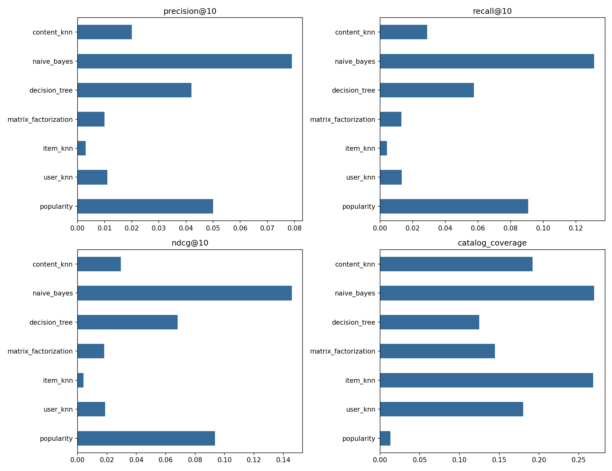

# Book recommendation comparison

## Aim
Compare neighbourhood and latent-factor collaborative filtering with three
content preference models on the same Goodbooks subset and held-out users.

## Methods
Algorithm definitions, feature choices, splits, hyperparameters and metric
definitions are documented in README.md.

## Results

The default experiment was executed locally with `python run_experiments.py --tune`:
500 users, 2,000 books, 37,111 ratings, seed 42, 20 factor-model epochs, no user
tags, and 100 sampled eligible test users. Neighbourhood size was selected from
10/30/50 using validation NDCG@10; final models were refitted on train+validation.
Exact splits, selected sizes, package versions and source hashes are saved in
`results/run_metadata.json`; validation trials are in `results/validation.csv`.

| Model | Precision@10 | Recall@10 | NDCG@10 | Catalogue coverage | RMSE |
|---|---:|---:|---:|---:|---:|
| Popularity | 0.0500 | 0.0909 | 0.0935 | 0.0130 | — |
| User kNN | 0.0110 | 0.0134 | 0.0188 | 0.1800 | 0.9130 |
| Item kNN | 0.0030 | 0.0042 | 0.0041 | 0.2680 | 0.8877 |
| Matrix factorization | 0.0100 | 0.0132 | 0.0181 | 0.1445 | 0.9196 |
| Content decision tree | 0.0420 | 0.0576 | 0.0681 | 0.1250 | — |
| Content Naive Bayes | 0.0790 | 0.1313 | 0.1457 | 0.2695 | — |
| Content kNN | 0.0200 | 0.0288 | 0.0294 | 0.1920 | — |

Naive Bayes achieved the highest ranking metrics in this particular experiment.
Popularity outperformed the other personalized models on NDCG, but covered only
1.3% of the catalog. Item kNN had the lowest rating RMSE among the collaborative
models while having the lowest NDCG overall: lower rating error did not imply
better top-ten recommendations. Sparse neighbourhood support, fallback scores,
and training rating objectives can affect full-catalog ranking. These are
plausible explanations, not isolated causal findings from this experiment.

The experiment uses a selected catalog, active-user restriction and a single
seed. Results do not establish a general winner for all books or users. Missing
ratings are unknown preferences; repeated-seed experiments and fuller model
tuning would be needed for stronger comparisons. See README.md for all metric
definitions and limitations. Full metrics, including MAE, content F1/AUC,
diversity and runtime, are in `results/metrics.csv`.

Validation: 13 automated checks passed locally, and all seven models completed
both a small end-to-end run and this default run. Notebook code cells compile.
